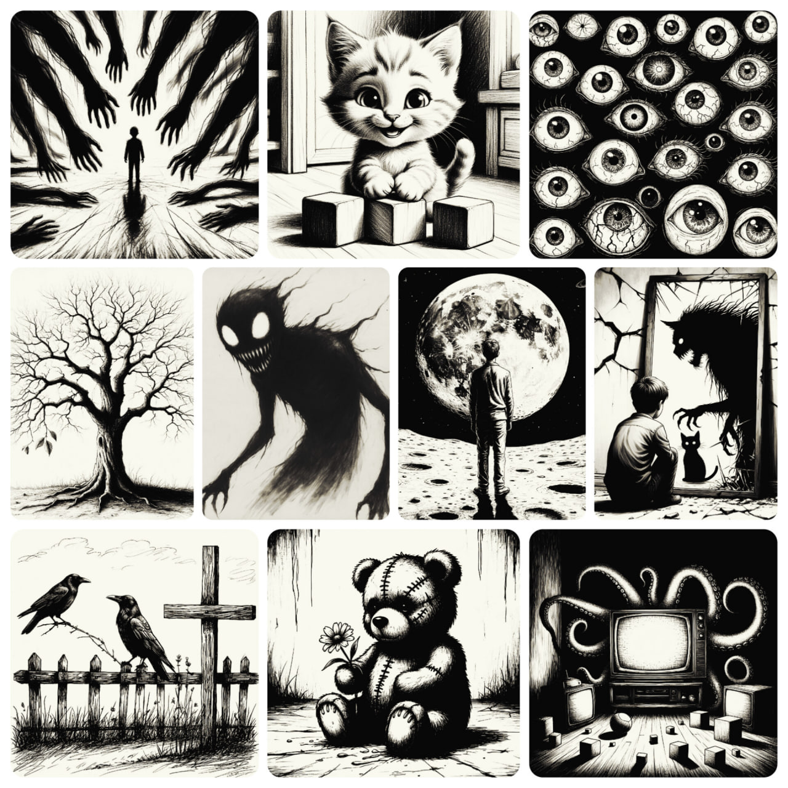

Всем привет! Меня зовут Женя. 35 🎂, ♂️, ♋️. Живу в Красноярске! Тут я родился, вырос, и... пока ещё не умер! 😼 

📌 Начну с главного: у меня есть диагнозы (как и у большинства присутствующих) с коморбидностью. Первоначальный диагноз ШРЛ, но этот диагноз не точный, и был поставлен давно. Сейчас что-то уже диагностировано, что-то в процессе диагностики. Список внушительный, но не с него начнём — не люблю знакомство с медкарты. Скажу только: я с ними не воюю. Мы давно договорились. Иногда они выигрывают, иногда я. В целом — стабильная ничья. К докторам хожу, таблеточки пью, ну а мысли о том, что я здоров, и в терапии более не нуждаюсь, своевременно отгоняю! 😽

ℹ️ Коротко обо мне: Пирожковых дел мастер. Интроверт. Многокотный котобатя: четыре спасённые жопки. Люблю готовить, читать, смотреть старое кино, играть и придумывать что-то. Восстанавливаюсь в тишине (и иногда в правильном шуме). Пытаюсь сделать свою игру. Но пока игра делает меня. 😸

⚠️ У меня сенсорная чувствительность: наслаждаюсь гулом тока в розетках, чувствую текстуры звука и слов, а от музыки бегают внутречерепные мурашки. Некоторые ощущения остаются со мной надолго. Иногда это красиво. Иногда — просто перегруз.

🧠 Мышление — ассоциативное, юмор — странный. Иногда я соединяю то, что не соединяется. Иногда это помогает. Иногда — просто веселит меня одного.

Я слишком долго имитировал типичность и увяз (тук, тук, Нео). Я немного социофоб, и у меня явные трудности с общением (которые усугубляются еще и моими "особенностями"), из-за чего я порой могу сказать глупость, или обидеть, не специально, и мне потом очень стыдно и неловко из-за этого. Иногда я вживаюсь в собеседника, и ощущаю его эмоции, а иногда и заражаюсь ими.

✅ Честно скажу, я сам пока не знаю кого и зачем ищу, друзей или что-то более... Наверное ищу то, что нужно всем и каждому? Найти человека, с которой можно молчать и не объяснять, почему я такой. Живую, мягкую, тёплую — а если ещё и с небольшой «безуминкой», то вообще идеально. С которой можно разделить тишину и музыку, (без)умные идеи и горячие беляшики. И не бояться, что тебя не поймут.

Возраст — 25–35 (20–40), но это не жёсткая рамка. Интроверт или мягкий амбиверт — то, что надо. Тату, пирсинг, шрамы — приветствуются. Любишь котиков, игры, кино, аниме, читать (что-то кроме соцсетей) и вкусно кушать? Мы совпадём. Готовлю я каждый день, вкусно и много — так что за компанию придётся гулять. Претензии за отъеденную на моих вкусняшках попу, не принимаю! 😸 

Если у тебя тоже есть особенности — нам точно будет о чём поговорить. Или помолчать. Я научился находить в своих не только трудности, но и радости. А если ты тоже иногда «чудишь» — вдвоём это будет веселее.

Если откликнулось — пиши. Я не кусаюсь (но это не точно). 😉 А если нет, ну что ж...

Если не знаешь, с чего начать — расскажи, какой звук тебя успокаивает. Или кинь песню, которую слушаешь на репите. Я отвечу тем же. У меня, например, на репите стиральная машинка. Иногда я к ней прислоняюсь. 😸

VK/Steam/TG: @dark7samurai

P.S. Пришлось вынести в отдельные списки, приношу извинения за неудобства! 😉

Что люблю и не люблю - https://telegra.ph/CHto-lyublyu-i-nelyublyu-11-09

Фильмы, сериалы, мультики, аниме, игры, книги - https://telegra.ph/Lyubimye-knigi-filmy-serialy-multiki-igry-anime-i-td-11-09

Из музыки: в ТГ в профиле есть плейлист.
